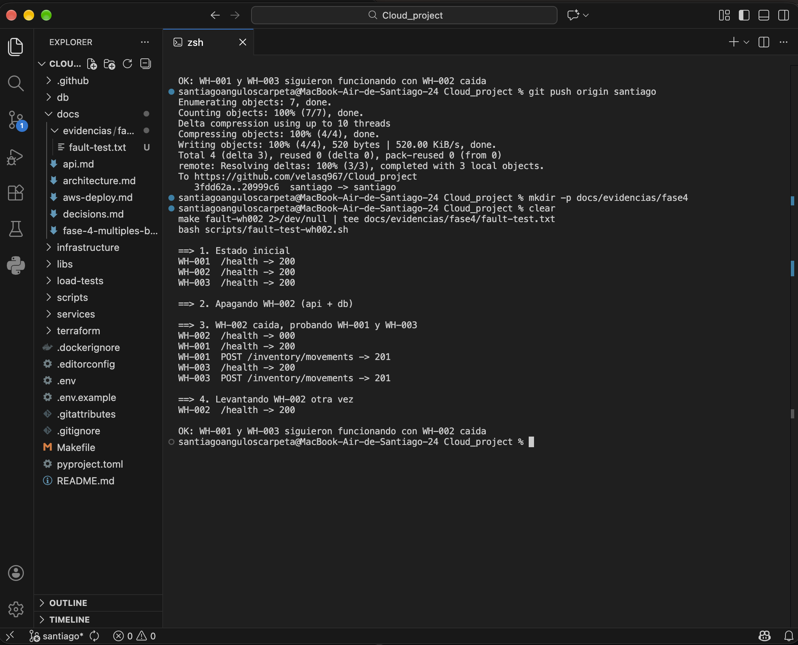
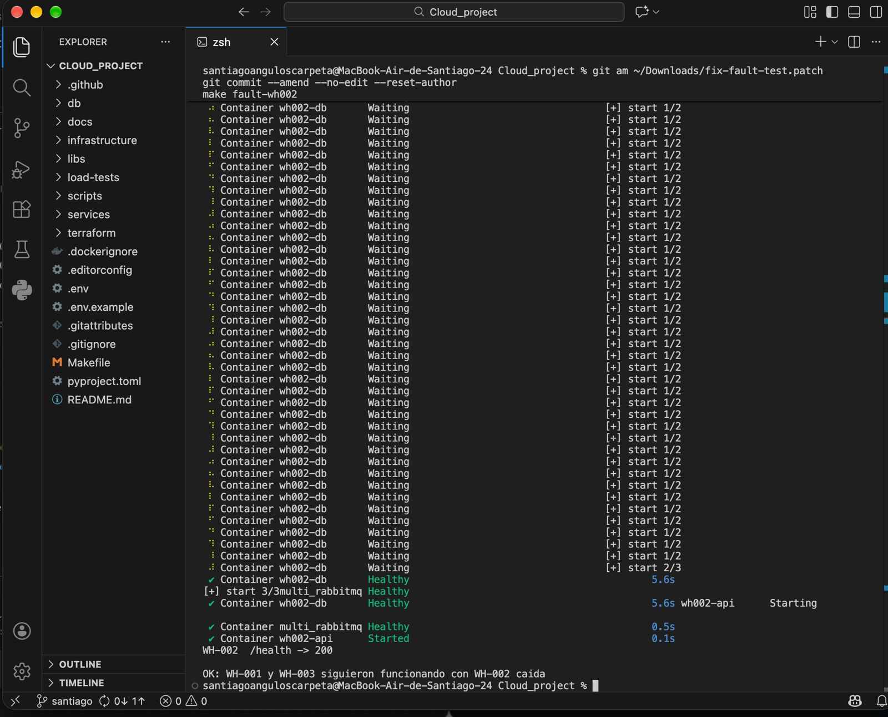

# Fase 4 - Múltiples bodegas

## Qué se hizo

Se pasó de una sola bodega a tres (WH-001, WH-002, WH-003). Cada una tiene su propia API, su PostgreSQL y su Redis, y ninguna toca la base de otra. Lo único que comparten es RabbitMQ.

```text
                 RabbitMQ (compartido)
        +-------------+-------------+
        |             |             |
     WH-001        WH-002        WH-003
   API :8001     API :8002     API :8003
   DB  :5441     DB  :5442     DB  :5443
   Redis :6381   Redis :6382   Redis :6383
   Front :8081   Front :8082   Front :8083
```

Los workers ahora escuchan solo los eventos de su bodega (`cache.inventory.WH-001.q`, `audit.events.WH-001.q`, etc.). Antes todos escuchaban `warehouse.*`, y con un Redis por bodega eso hacía que el cache-worker de una bodega pudiera borrar la caché de otra.

Las decisiones están en `docs/decisions.md` (ADR-010 a ADR-012).

## Cómo correrlo

Primero apagar el stack de la fase 3 (`make down`), porque usan los mismos puertos de RabbitMQ.

```bash
cp .env.example .env
make up-multi
make ps-multi
```

Probar que las tres responden:

```bash
curl localhost:8001/health
curl localhost:8002/health
curl localhost:8003/health
```

En http://localhost:15672 (warehouse / warehouse_pass), en Queues, deben salir 9 colas (3 por bodega).

Para ver que los datos están separados, se hace un movimiento en WH-001 y se revisa que WH-002 no cambia:

```bash
curl -X POST localhost:8001/inventory/movements -H 'Content-Type: application/json' \
  -d '{"product_id":1,"type":"RECEIPT","quantity":10,"reference":"demo"}'
curl localhost:8001/inventory/1
curl localhost:8002/inventory/1
```

## Prueba: WH-002 caída

```bash
make fault-wh002
```

En Windows: `powershell -ExecutionPolicy Bypass -File .\scripts\fault-test-wh002.ps1`

El script apaga la API y la base de WH-002, revisa que WH-001 y WH-003 siguen respondiendo y aceptando movimientos, y después vuelve a prender WH-002.

Resultado obtenido:





Salida completa en texto: [fault-test.txt](evidencias/fase4/fault-test.txt)

## Prueba de carga

El enunciado pide 50, 800 y 20 req/s. En un portátil 800 req/s no se alcanza, así que se usa `SCALE` para bajar las tres tasas en la misma proporción.

```bash
make load-multi              # SCALE=0.1 -> 5 / 80 / 2 req/s
SCALE=0.5 make load-multi    # 25 / 400 / 10 req/s
```

| Bodega | req/s pedido | req/s logrado | p95 (ms) | % error |
|---|---:|---:|---:|---:|
| WH-001 | | | | |
| WH-002 | | | | |
| WH-003 | | | | |

SCALE usado: ___

## ¿Por qué no escalar todas las bodegas igual?

- Si las tres se dimensionan para 800 req/s, WH-001 y WH-003 quedan casi sin usar y se paga por capacidad que no necesitan.
- No todas tienen el mismo problema: WH-002 es de mucha lectura, así que le sirve más caché y más réplicas de la API (fase 5). Una bodega con muchas escrituras necesitaría más base de datos.
- Si compartieran recursos, un pico en WH-002 haría lenta a las demás. Separadas, el problema se queda en WH-002.
- Cada bodega se puede reiniciar o actualizar sin afectar a las otras.
- Lo malo: hay más cosas que administrar y ya no se puede sacar el inventario total con una consulta SQL. Eso se resuelve en la fase 7.

## AWS

```bash
cd terraform
cp terraform.tfvars.example terraform.tfvars   # poner la IP propia y una clave para rabbit
terraform init
terraform apply
terraform output warehouses
```

Se crea la VPC con salida a internet, los security groups, una EC2 central con RabbitMQ y una EC2 por bodega. Cada EC2 instala Docker, clona el repo y levanta `compose.node.yml` con su `WAREHOUSE_ID`. WH-002 usa t3.medium y las otras t3.small.

Para probar el fallo en AWS se detiene la instancia de WH-002 desde la consola y se revisa `http://<ip>:8000/health` de las otras dos.

Al terminar: `terraform destroy`.
