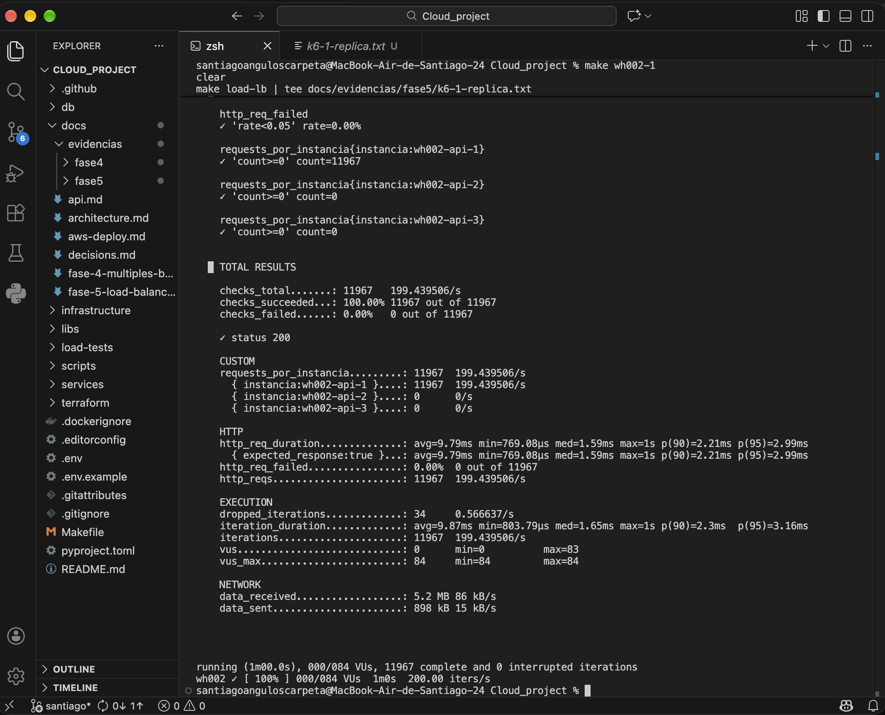
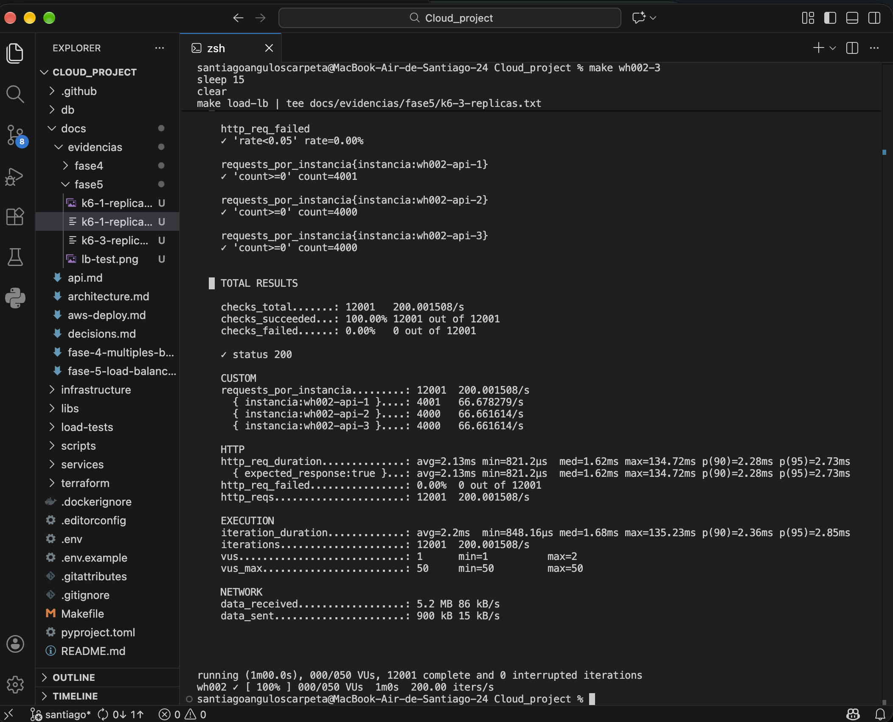
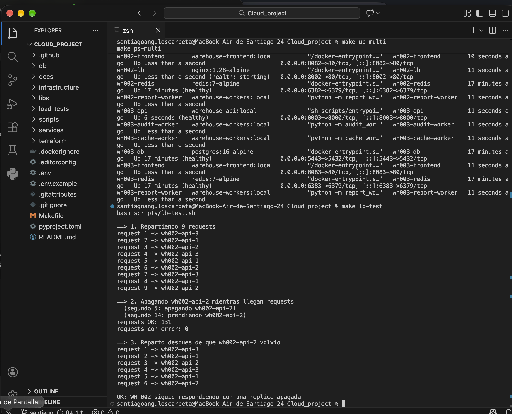

# Fase 5 - Load balancing y escalamiento

## Qué se hizo

WH-002 (la bodega de alta carga) ahora tiene 3 réplicas de la API detrás de un Nginx. Las tres usan el mismo Redis y la misma PostgreSQL de WH-002.

```text
            localhost:8002
                 |
           Nginx (wh002-lb)
                 |
     +-----------+-----------+
     |           |           |
wh002-api-1 wh002-api-2 wh002-api-3
     |           |           |
     +-----------+-----------+
                 |
          wh002-redis (compartido)
                 |
           wh002-db (compartida)
```

- Nginx reparte con round robin (`services/load-balancer/nginx.conf`).
- Cada respuesta trae el header `X-Instance-Id` con el nombre de la réplica que la atendió. Así se ve el balanceo.
- Si una réplica se apaga, Nginx la saca del pool y reintenta el request en otra (`proxy_next_upstream`). Cuando vuelve, la agrega sola.
- Cada réplica tiene un límite de 1 CPU (`cpus: 1.0`), como si fueran máquinas separadas.
- WH-001 y WH-003 siguen con una sola API, porque su carga no lo necesita.

Las decisiones están en `docs/decisions.md` (ADR-013 y ADR-014).

## Cómo correrlo

```bash
make down-multi
make up-multi
make ps-multi     # deben salir wh002-api-1, wh002-api-2, wh002-api-3 y wh002-lb
```

Ver el reparto a mano:

```bash
for i in 1 2 3 4 5 6; do curl -s -D - -o /dev/null localhost:8002/health | grep -i x-instance-id; done
```

Debe ir rotando: `wh002-api-1`, `wh002-api-2`, `wh002-api-3`, ...

## Experimento 1: una instancia

```bash
make wh002-1                 # apaga api-2 y api-3
RATE=200 make load-lb
```

## Experimento 2: tres instancias

```bash
make wh002-3                 # prende api-2 y api-3
RATE=200 make load-lb
```

Si con 200 req/s no se nota diferencia, subir la tasa (`RATE=400`, `RATE=800`) y repetir los dos experimentos con el mismo valor.

### Resultados (60 s a 200 req/s, en un MacBook Air)

| Experimento | Réplicas | Requests | req/s logrado | Promedio (ms) | Mediana (ms) | p95 (ms) | Máximo (ms) | % error | Requests descartados |
|---|---:|---:|---:|---:|---:|---:|---:|---:|---:|
| 1 | 1 | 11.967 | 199,4 | 9,79 | 1,59 | 2,99 | 1.000 | 0 % | 34 |
| 2 | 3 | 12.001 | 200,0 | 2,13 | 1,62 | 2,73 | 134,7 | 0 % | 0 |

Reparto de requests por réplica:

| Réplica | Experimento 1 | Experimento 2 |
|---|---:|---:|
| wh002-api-1 | 11.967 | 4.001 |
| wh002-api-2 | 0 | 4.000 |
| wh002-api-3 | 0 | 4.000 |





Salida completa: [k6-1-replica.txt](evidencias/fase5/k6-1-replica.txt) y [k6-3-replicas.txt](evidencias/fase5/k6-3-replicas.txt)

### Análisis

- **Las dos configuraciones atendieron la carga sin errores**, pero con 1 réplica el sistema ya estaba al límite. k6 tuvo que descartar 34 requests porque no alcanzaba a mandarlos a tiempo y llegó a usar 84 usuarios virtuales. Con 3 réplicas no se descartó ninguno y bastaron 50.
- **La latencia promedio bajó de 9,79 ms a 2,13 ms** (unas 4,6 veces menos) y **el máximo bajó de 1 s a 135 ms**. Con una sola réplica hubo picos en los que los requests se quedaban esperando en cola. Con tres, la carga se reparte y esos picos casi desaparecen.
- La mediana y el p95 son parecidos en los dos casos (~1,6 ms y ~3 ms). La mayoría de los requests son rápidos porque se responden desde Redis. La diferencia está en los requests más lentos, que son los que suben el promedio.
- **El reparto fue casi perfecto**: 4.001 / 4.000 / 4.000. Nginx usa round robin.
- A 200 req/s la mejora se ve en la estabilidad más que en el throughput, porque las dos configuraciones alcanzan los 200 req/s. Con más carga (por ejemplo `RATE=600`), una sola réplica empezaría a quedarse por debajo de la tasa pedida.

## Experimento 3: apagar una instancia

```bash
make lb-test
```

En Windows: `powershell -ExecutionPolicy Bypass -File .\scripts\lb-test.ps1`

El script:
1. manda 9 requests y muestra qué réplica atendió cada uno;
2. durante 20 segundos manda requests seguidos, apaga `wh002-api-2` en el segundo 5 y la vuelve a prender en el 14;
3. cuenta cuántos requests fallaron (deben ser 0) y muestra que `wh002-api-2` vuelve a recibir tráfico.

Resultado obtenido:



Con `wh002-api-2` apagada hubo 131 requests OK y 0 con error. Antes de apagarla y después de prenderla, el reparto rota entre las tres réplicas.

## Preguntas

**¿Qué ocurre si Redis es local de cada instancia?**
Cada réplica tendría su propia caché. Un mismo producto podría estar guardado con valores distintos en cada una, y la respuesta dependería de a qué réplica te mande el balanceador.

**¿Por qué puede ser problemático?**
Porque cuando hay un movimiento solo se limpia la caché de la réplica que lo atendió (y la del cache-worker). Las otras dos siguen devolviendo el stock viejo hasta que venza el TTL. Por ejemplo, la réplica 1 dice que hay 100 unidades y la réplica 2 dice 70: el usuario ve números distintos al recargar. Además, cada réplica tendría que llenar su caché desde cero, así que hay más consultas a PostgreSQL.

**¿Dónde debería vivir el estado compartido?**
Fuera de las réplicas, en servicios que todas usan: PostgreSQL para los datos (inventario, movimientos) y Redis para la caché. En este proyecto cada bodega tiene los suyos y las réplicas de WH-002 comparten los de WH-002.

**¿Qué significa que una API sea stateless?**
Que no guarda nada importante en su memoria entre un request y otro. Cada request trae todo lo que necesita y la API lee y escribe en la base o en Redis. Por eso cualquier réplica puede atender cualquier request, se pueden agregar o quitar réplicas sin perder datos, y si una se cae no se pierde nada.

## AWS

En AWS el Nginx se reemplazaría por un Application Load Balancer (ALB) con un target group que use `GET /health` como health check y las réplicas de WH-002 como targets. La idea es la misma: el ALB solo manda tráfico a las réplicas sanas.
