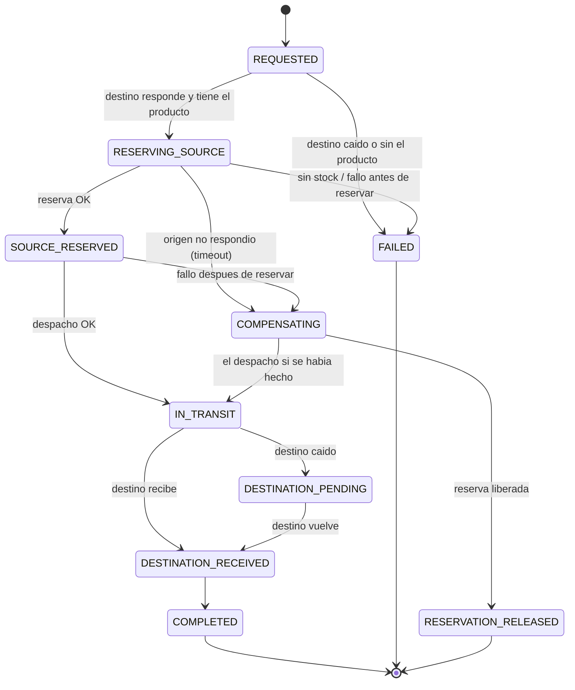
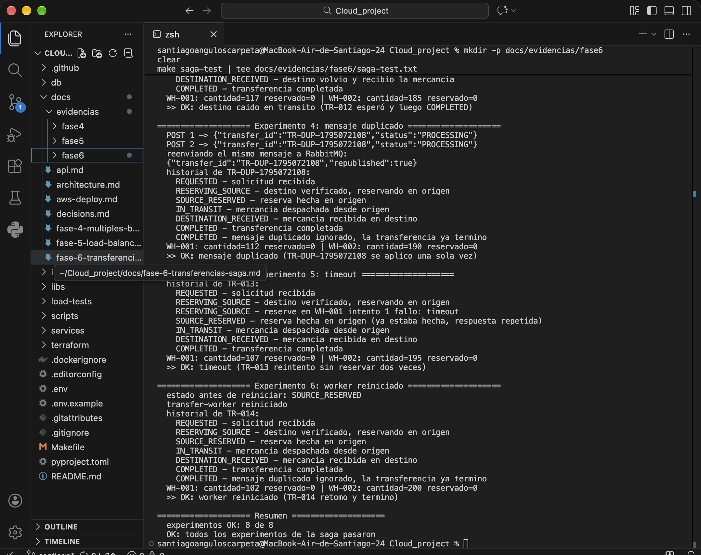

# Fase 6 - Transferencias y Saga

## El problema

Transferir 30 unidades de PROD-001 de WH-001 a WH-002 toca dos bases de datos distintas (`wh001-db` y `wh002-db`). No hay una transacción SQL que cubra las dos, así que si algo falla a mitad de camino podríamos quedar con stock descontado en WH-001 que nunca llegó a WH-002.

La solución es una **Saga orquestada**: la transferencia se divide en pasos locales (cada uno es una transacción normal dentro de una sola bodega) y un orquestador los ejecuta en orden. Si algo falla antes del punto de no retorno, el orquestador deshace lo hecho con una **compensación**.

## Arquitectura

```text
           POST /transfers (202)
                  |
             central-api ----> central-db (transfers + transfer_history)
                  |
        TRANSFER_REQUESTED (RabbitMQ, cola transfers.saga.q)
                  |
           transfer-worker  (ejecuta la saga)
             |           |
             v           v
          WH-001       WH-002
   /internal/transfers/{id}/{paso}
```

- **central-api** (`localhost:8010`) recibe la solicitud, la guarda en `central-db`, publica `TRANSFER_REQUESTED` y responde `202 Accepted` de una vez.
- **transfer-worker** consume el mensaje y avanza la saga. Cada cambio de estado se guarda en la base antes de seguir, así que si el worker se cae puede retomar donde quedó. Cada 5 segundos también revisa la tabla y retoma las transferencias que no han terminado.
- **Cada bodega** tiene endpoints internos para los pasos: `check`, `reserve`, `dispatch`, `receive` y `cancel`.

Código: `services/central/` (orquestador) y `services/warehouse-api/app/modules/transfers/` (pasos en la bodega).

## Diagrama de estados



Versión en texto:

```text
REQUESTED --> RESERVING_SOURCE --> SOURCE_RESERVED --> IN_TRANSIT --> DESTINATION_RECEIVED --> COMPLETED
    |               |   |                |                  |
    v               v   +----------+     |                  v
  FAILED         FAILED            v     v           DESTINATION_PENDING (reintenta hasta que el destino vuelva)
                               COMPENSATING
                                    |
                                    v
                           RESERVATION_RELEASED
```

Estados finales: `COMPLETED`, `FAILED` y `RESERVATION_RELEASED`.

## Pasos en cada bodega

| Paso | Bodega | Qué hace | Movimiento |
|---|---|---|---|
| `check` | destino | Verifica que responde y que tiene el producto | - |
| `reserve` | origen | `reservado += 30` (si hay disponible) | RESERVATION |
| `dispatch` | origen | `reservado -= 30`, `cantidad -= 30` | TRANSFER_OUT |
| `receive` | destino | `cantidad += 30` | TRANSFER_IN |
| `cancel` | origen | Compensación: libera la reserva si existe | RELEASE |

Todos los movimientos quedan con `reference = transfer_id`, así que en el historial de inventario se ve qué transferencia los causó.

## Compensaciones

**¿Qué se compensa?** Solo la reserva en el origen. El paso `dispatch` es el **punto de no retorno**: antes de él todo se puede deshacer; después, la mercancía ya salió y la saga solo puede ir hacia adelante.

| Falla en... | Estado | Compensación | Por qué |
|---|---|---|---|
| `check` (destino caído o sin producto) | `FAILED` | Ninguna | Todavía no se había tocado nada. |
| Antes de `reserve` | `FAILED` | Ninguna | Igual, no hay nada que deshacer. |
| `reserve` rechazado (sin stock) | `FAILED` | Ninguna | La bodega no reservó nada. |
| `reserve` sin respuesta (timeout) | `COMPENSATING` → `RESERVATION_RELEASED` | `cancel` en origen | No sabemos si la reserva quedó. `cancel` revisa: si había reserva la libera, si no, no hace nada. |
| Después de `reserve` | `COMPENSATING` → `RESERVATION_RELEASED` | `cancel` en origen | Se libera lo reservado y el stock vuelve a estar disponible. |
| `dispatch` sin respuesta | `COMPENSATING` → `IN_TRANSIT` | `cancel` detecta que ya se despachó | Si el despacho sí quedó, cancelar sería perder mercancía. La saga sigue hacia adelante. |
| `receive` (destino caído) | `DESTINATION_PENDING` | Ninguna, se reintenta | La mercancía ya salió del origen. Se reintenta `receive` hasta que el destino vuelva (es idempotente, así que reintentar es seguro). |

Si el origen tampoco responde durante la compensación, la transferencia se queda en `COMPENSATING` y el worker la reintenta cada 5 segundos hasta que el origen vuelva.

Una protección extra: cuando `cancel` se ejecuta, queda guardado. Si después llega tarde una `reserve` de esa misma transferencia (por ejemplo, un request que se había quedado colgado en la red), la bodega la rechaza con 409. Así no queda una reserva "huérfana".

## Idempotencia

Hay idempotencia en tres niveles:

1. **API central:** si se manda `POST /transfers` dos veces con el mismo `transfer_id`, la segunda vez se devuelve la misma transferencia y no se crea otra.
2. **Worker:** si llega un mensaje de una transferencia que ya terminó, se ignora y queda anotado en el historial ("mensaje duplicado ignorado"). Además hay un lock por transferencia (`pg_try_advisory_lock`) para que dos workers no la procesen al mismo tiempo.
3. **Bodegas:** cada paso aplicado se guarda en la tabla `transfer_operations` con `UNIQUE (transfer_id, step)`. Si el mismo paso llega dos veces, la bodega responde `already_done: true` sin tocar el inventario. El lock de la fila de inventario (`SELECT ... FOR UPDATE`) evita que dos requests iguales pasen al mismo tiempo.

Gracias al nivel 3, reintentar cualquier paso es seguro, que es lo que permite resolver el timeout y el reinicio del worker.

## Cómo correrlo

```bash
make up-multi
make saga-test
```

Transferencia manual:

```bash
curl -X POST localhost:8010/transfers -H 'Content-Type: application/json' \
  -d '{"source_warehouse":"WH-001","destination_warehouse":"WH-002","sku":"PROD-001","quantity":30}'

curl localhost:8010/transfers/TR-001     # estado e historial
```

Logs del orquestador: `make logs-saga`.

## Experimentos

`make saga-test` corre el caso del enunciado y los 6 experimentos, y revisa el inventario antes y después de cada uno. Para los experimentos se usa el campo `simulate` en el `POST /transfers`:

| # | Experimento | Cómo se provoca | Resultado esperado |
|---|---|---|---|
| - | Caso del enunciado | 30 unidades WH-001 → WH-002 | `COMPLETED`, WH-001 -30, WH-002 +30 |
| 1 | Fallar antes de reservar | `simulate: fail_before_reserve` | `FAILED`, inventario igual |
| 2 | Fallar después de reservar | `simulate: fail_after_reserve` | `COMPENSATING` → `RESERVATION_RELEASED`, reserva liberada |
| 3a | Destino caído desde el inicio | Se apaga WH-002 antes de crear la transferencia | `FAILED` en `check`, no se mueve nada |
| 3b | Destino caído con la mercancía en camino | `simulate: pause_before_receive` y se apaga WH-002 durante la pausa | `DESTINATION_PENDING` mientras está caída, `COMPLETED` cuando vuelve |
| 4 | Mensaje duplicado | Mismo `transfer_id` dos veces + reenvío del mensaje a RabbitMQ | Se aplica una sola vez |
| 5 | Timeout | `simulate: timeout`: la bodega reserva pero tarda 5 s en responder y el worker corta a los 3 s | El worker reintenta, la bodega responde `already_done` y termina `COMPLETED` sin reservar dos veces |
| 6 | Worker reiniciado | `simulate: slow` (4 s entre pasos) y `docker restart transfer-worker` a mitad | Al arrancar, el worker retoma desde el último estado guardado y termina `COMPLETED` |

### Resultados



Salida completa: [saga-test.txt](evidencias/fase6/saga-test.txt)

## Limitaciones

- El orquestador es un solo worker. Para tener más, el lock por transferencia ya evita que dos procesen la misma.
- Si RabbitMQ se cae, el mensaje `TRANSFER_REQUESTED` se pierde, pero la transferencia ya está guardada en `central-db` y el worker la recoge en la siguiente revisión. Es parecido a un Outbox simple; el Outbox completo es de la fase 10.
- `DESTINATION_PENDING` se reintenta sin límite. En un sistema real habría una alerta para que alguien revise si el destino no vuelve en mucho tiempo.
