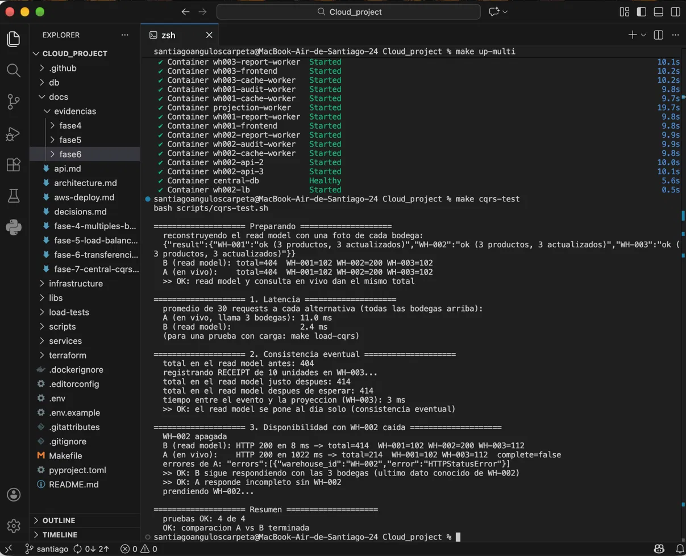
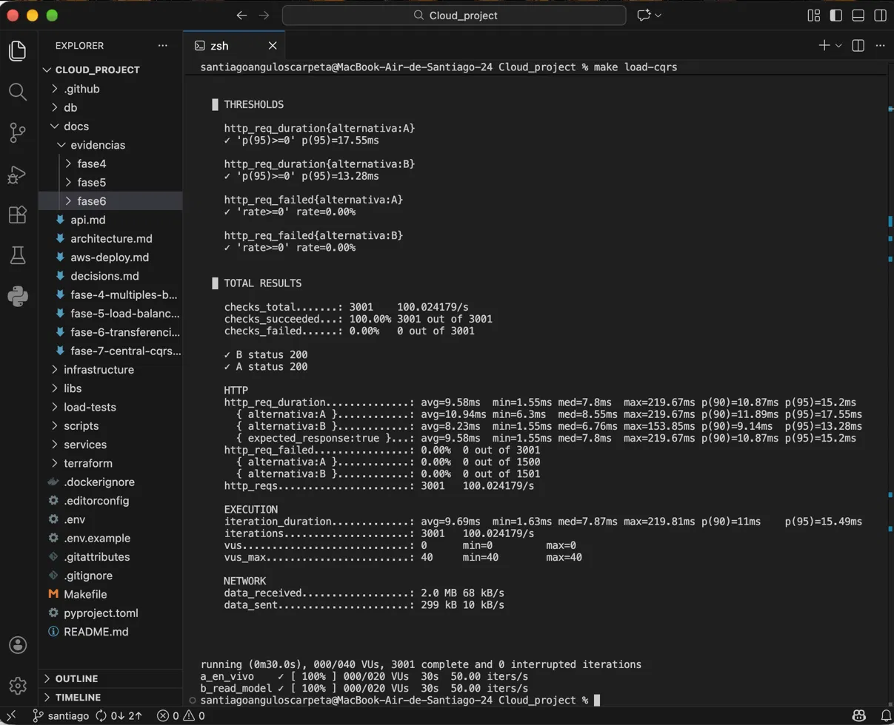

# Fase 7 - Plataforma central y CQRS

## El problema

La central necesita responder "¿cuánto PROD-001 hay en total entre todas las bodegas?":

```http
GET /global/inventory/PROD-001
```

Cada bodega tiene su propia base de datos (fase 4), así que no hay una tabla con el total. Hay dos formas de resolverlo y el enunciado pide compararlas.

## Alternativa A: consultar en vivo

```text
GET /global/inventory-live/PROD-001
        |
   central-api
     |    |    |      (en paralelo, timeout de 2 s)
   WH-001 WH-002 WH-003
```

En cada request, la central le pregunta a las 3 bodegas (`GET /internal/inventory?sku=...`) y suma. Si una bodega no responde, la respuesta sale con `"complete": false` y la lista de errores.

## Alternativa B: read model (CQRS)

```text
Command side (escrituras)              Query side (lecturas)

API de la bodega                      GET /global/inventory/PROD-001
      |                                         |
Base de la bodega                          central-api
      |                                         |
INVENTORY_UPDATED ---> RabbitMQ ---> projection-worker ---> global_inventory (central-db)
```

- Cada vez que cambia el inventario de una bodega, esta publica `INVENTORY_UPDATED` con el SKU y el stock nuevo.
- `projection-worker` escucha esos eventos de todas las bodegas (cola `central.projection.q`, routing key `warehouse.*.INVENTORY_UPDATED`) y guarda el último stock conocido en la tabla `global_inventory` (una fila por bodega y SKU).
- `GET /global/inventory/{sku}` lee solo esa tabla. No llama a ninguna bodega.

Las escrituras (command side) siguen yendo a la base de cada bodega. Las lecturas globales (query side) van al read model. Eso es CQRS: modelos separados para escribir y para leer.

### Detalles del read model

- **SKU como llave.** El `product_id` es distinto en cada base, así que el evento ahora incluye el `sku`, que sí es igual en todas.
- **Eventos duplicados o desordenados.** Cada fila guarda la fecha del último evento aplicado (`last_event_at`). Un evento solo se aplica si es más nuevo. Un duplicado tiene la misma fecha y se ignora, y uno que llega tarde es más viejo y también se ignora. Esto se hace en un solo `INSERT ... ON CONFLICT DO UPDATE ... WHERE` en PostgreSQL.
- **Reconstrucción.** El stock inicial (el seed) no genera eventos. Por eso, al arrancar, el worker pide una foto del inventario a cada bodega y llena la tabla. También se puede pedir con `POST /global/rebuild` si el read model se pierde o se desincroniza.
- **En tránsito.** La respuesta incluye `in_transit`: las unidades de transferencias (fase 6) que ya salieron del origen y no han llegado al destino. Sin esto, durante una transferencia el total parecería más bajo.
- **Qué tan viejo es el dato.** Para cada bodega la respuesta incluye `last_update`, `age_seconds` (hace cuánto llegó el último evento) y `projection_lag_ms` (cuánto tardó el evento en aplicarse).

Ejemplo de respuesta:

```json
{
  "sku": "PROD-001",
  "source": "read_model",
  "total_quantity": 302,
  "total_reserved": 0,
  "total_available": 302,
  "in_transit": 0,
  "warehouses": [
    {"warehouse_id": "WH-001", "quantity": 52, "reserved_quantity": 0, "available_quantity": 52, "age_seconds": 12.4, "projection_lag_ms": 18},
    {"warehouse_id": "WH-002", "quantity": 150, "...": "..."},
    {"warehouse_id": "WH-003", "quantity": 100, "...": "..."}
  ]
}
```

## Cómo correrlo

```bash
make up-multi
make cqrs-test     # latencia, consistencia y disponibilidad de A vs B
make load-cqrs     # carga con k6 a las dos alternativas (RATE=50 por defecto)
```

A mano:

```bash
curl localhost:8010/global/inventory/PROD-001        # B: read model
curl localhost:8010/global/inventory-live/PROD-001   # A: en vivo
curl localhost:8010/global/inventory                 # todos los sku
curl -X POST localhost:8010/global/rebuild           # reconstruir el read model
```

## Experimentos

`make cqrs-test` hace:

1. **Latencia:** 30 requests a cada alternativa y el promedio.
2. **Consistencia:** registra un RECEIPT de 10 unidades en WH-003, consulta el read model justo después y espera a que se ponga al día. Muestra cuánto tardó el evento en llegar al read model.
3. **Disponibilidad:** apaga WH-002 y consulta las dos alternativas.

### Resultados

Medido en un MacBook Air con todo corriendo en Docker.





| | A: en vivo | B: read model |
|---|---:|---:|
| Latencia promedio, 30 requests seguidos (`cqrs-test`) | 11,0 ms | 2,4 ms |
| Con carga de 50 req/s cada una por 30 s (`load-cqrs`): promedio | 10,94 ms | 8,23 ms |
| Con carga: mediana | 8,55 ms | 6,76 ms |
| Con carga: p95 | 17,55 ms | 13,28 ms |
| Con carga: máximo | 219,7 ms | 153,9 ms |
| Errores con carga | 0 % | 0 % |
| Tiempo hasta reflejar un cambio (RECEIPT en WH-003) | inmediato | 3 ms |
| Con WH-002 caída | HTTP 200 en **1.022 ms**, total 214, `complete: false` | HTTP 200 en **8 ms**, total 414 con las 3 bodegas |

**Qué muestran los números:**

- **Latencia:** B fue unas 4,5 veces más rápida en requests sueltos (2,4 vs 11 ms). Con carga la diferencia es menor (p95 de 13 vs 18 ms), porque aquí todo corre en el mismo computador y la "red" entre la central y las bodegas casi no cuesta nada. En AWS cada bodega estaría en otra máquina y A pagaría la latencia de red real en cada request.
- **Consistencia:** el evento llegó al read model en 3 ms, tan rápido que la consulta justo después del RECEIPT ya mostraba el valor nuevo. El atraso existe (consistencia eventual), pero en condiciones normales es de milisegundos.
- **Disponibilidad:** es la diferencia más grande. Con WH-002 caída, B respondió en 8 ms con las 3 bodegas (WH-002 con su último dato conocido). A tardó más de 1 segundo esperando a WH-002 y devolvió un total incompleto (214 en vez de 414), que alguien podría leer como el total real si no revisa `complete`.

## Comparación

| Criterio | A: consulta en vivo | B: read model (CQRS) |
|---|---|---|
| **Latencia** | La de la bodega más lenta más la red. Crece con el número de bodegas y si una está lenta, toda la consulta se pone lenta (hasta el timeout de 2 s). | Una consulta a una sola tabla local. Casi no cambia con el número de bodegas. |
| **Disponibilidad** | Depende de que todas las bodegas respondan. Con una caída, la respuesta es parcial (`complete: false`). | Sigue respondiendo aunque las bodegas estén caídas, con el último dato conocido. Solo depende de `central-db`. |
| **Consistencia** | Fuerte: muestra el stock de este momento. | Eventual: puede ir atrasado unos milisegundos (lo que tarda el evento), o más si RabbitMQ o el worker están caídos. Mientras una bodega está caída, su dato se queda congelado en el último valor. |
| **Complejidad** | Baja: un endpoint que llama y suma. | Mayor: eventos con SKU, un worker más, una tabla más, manejo de duplicados y desorden, y reconstrucción inicial. |
| **Dependencia de servicios** | Fuerte, de las N bodegas en cada request. Más bodegas significa más carga sobre ellas por cada consulta global. | De RabbitMQ y del projection worker para estar al día, pero no para responder. Las bodegas no reciben carga por las consultas globales. |

**Conclusión:** para un tablero o una consulta frecuente del inventario global, B es mejor: responde rápido, no carga a las bodegas y sigue funcionando si una se cae. A tiene sentido cuando se necesita el dato exacto de este instante y se acepta que sea más lento y que falle si una bodega no responde. Por ejemplo, antes de comprometer una venta grande se puede confirmar con la bodega puntual.

## Limitaciones

- Si RabbitMQ se cae, la bodega no puede publicar y esos eventos se pierden (el publisher actual no reintenta). El read model queda atrasado hasta el siguiente cambio o hasta un `POST /global/rebuild`. Esto se resuelve con el Outbox de la fase 10.
- El read model no sabe si una bodega está caída; solo sabe hace cuánto no recibe eventos de ella (`age_seconds`).
